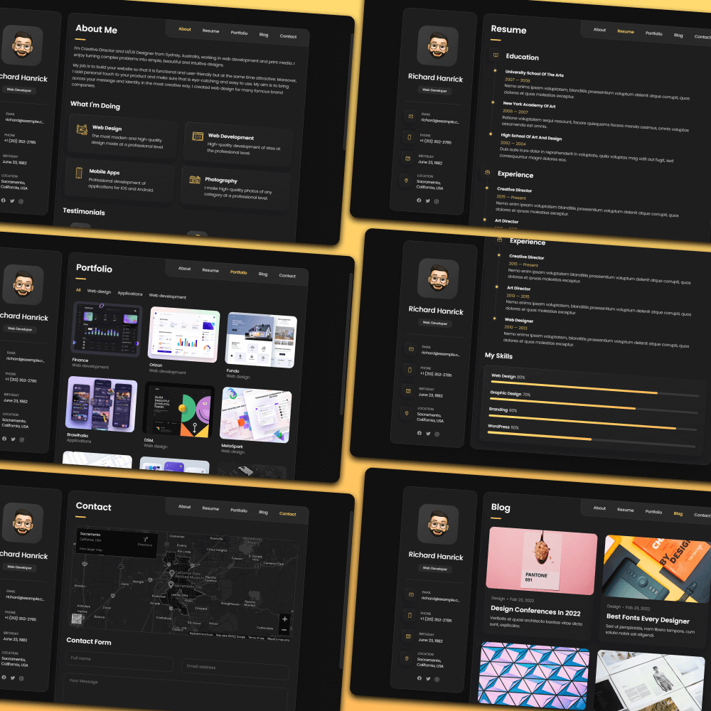
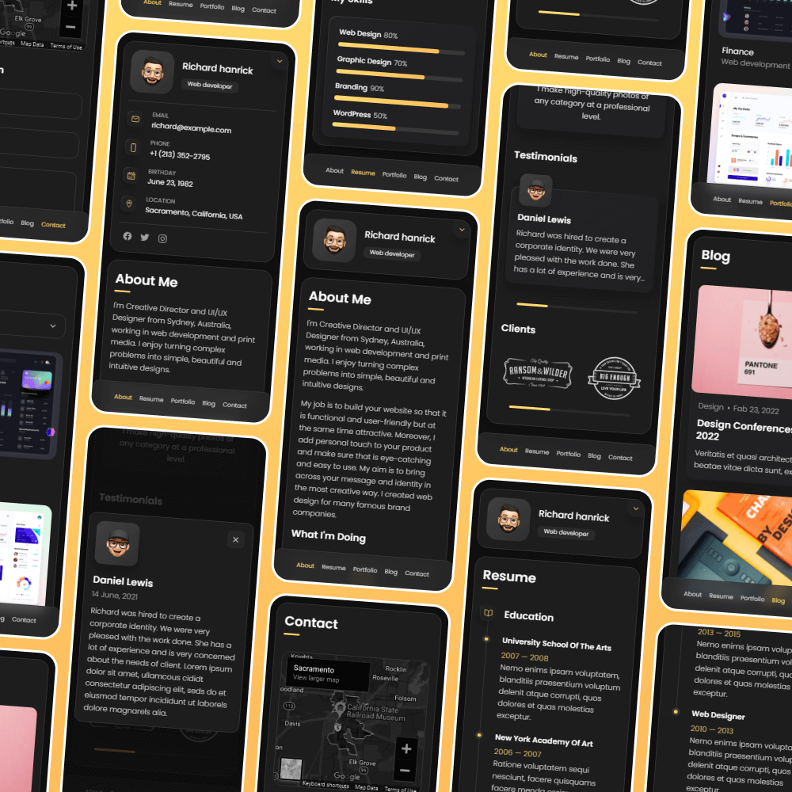

# 🎨 Vision Craft — Creative Portfolio & Digital Studio

[](https://developer.mozilla.org/en-US/docs/Web/HTML)
[](https://developer.mozilla.org/en-US/docs/Web/CSS)
[](https://developer.mozilla.org/en-US/docs/Web/JavaScript)
[](https://developer.mozilla.org/en-US/docs/Learn/CSS/CSS_layout/Responsive_Design)
[](LICENSE)

**Vision Craft** is a modern, responsive personal portfolio and creative digital agency showcase website. Engineered with high-performance Vanilla HTML5, CSS3, and JavaScript, it features a sleek dark-mode glassmorphic aesthetic, dynamic single-page navigation, portfolio category filtering, testimonial modals, and comprehensive primary and alternative contact channels.

---

## 📸 Previews

| Desktop View | Mobile View |
| :---: | :---: |
|  |  |

---

## ✨ Features & Architecture

### 🧭 1. Dynamic Single-Page Navigation
- Fluid switching across **About**, **Resume**, **Portfolio**, **Blog**, and **Contact** sections without page reloads.
- Responsive tab bar for desktop and mobile bottom-anchored sticky navigation.

### 👤 2. Interactive Profile Sidebar
- Collapsible sidebar for mobile and tablet with smooth height transitions.
- Displays brand identity, role, primary and alternative contact channels, and social media handles.
- Always-visible sticky sidebar on desktop displays (1250px+).

### 💼 3. Comprehensive Service & Resume Presentation
- **What We Do**: Showcases Web Design, Full-Stack Web Development, Mobile Apps, and Photography with custom vector iconography.
- **Experience & Education**: Timeline milestones with dates, credentials, and achievements.
- **Interactive Skills**: Animated percentage bars for core proficiencies (Web Design 80%, Graphic Design 70%, Branding 90%, WordPress 50%).

### 🖼️ 4. Category-Filtered Portfolio
- Real-time client-side project filtering with categories:
  - `All`
  - `Web design`
  - `Applications`
  - `Web development`
- Dropdown select filter for mobile viewports and button pill filters for desktop.

### 💬 5. Interactive Testimonials & Modal
- Horizontally scrollable client reviews with custom scrollbars.
- Click-to-open modal dialog providing full feedback details with backdrop blur.

### 📬 6. Contact Section with Dual Communication Matrix
- Integrated interactive Google Maps location view.
- Comprehensive contact channel cards with both **Primary** and **Alternative** communication options.
- Client-side validated contact form with real-time submit button activation.

---

## 📞 Contact Information Matrix

Vision Craft provides both primary and backup communication channels to ensure seamless client communication:

| Channel | Primary Channel | Alternative / Backup Channel |
| :--- | :--- | :--- |
| **📧 Email Address** | [`hello@visioncraft.studio`](mailto:hello@visioncraft.studio) | [`support@visioncraft.io`](mailto:support@visioncraft.io) |
| **📞 Telephone Line** | [`+1 (555) 349-2810`](tel:+15553492810) (Direct Line) | [`+1 (800) 847-4660`](tel:+18008474660) (Toll-Free Hotline) |
| **🏢 Physical Studio** | **HQ Studio:** 742 Evergreen Terrace, San Francisco, CA 94107, USA | **Alternative Creative Hub:** 100 Innovation Way, Austin, TX 78701, USA |
| **⏰ Business Hours** | Mon – Fri: 09:00 AM – 06:00 PM (PST) | Sat: 10:00 AM – 02:00 PM (Emergency On-Call) |
| **🌐 Social Profiles** | [Twitter / X](https://twitter.com/visioncraft_) | [Instagram](https://instagram.com/visioncraft_design) • [Facebook](https://facebook.com/visioncraftstudio) |

---

## 📂 Project Structure

```plaintext
Vision-Craft/
├── assets/
│   ├── css/
│   │   └── style.css            # Custom CSS styling, variables, dark theme & media queries
│   ├── images/                  # Avatars, project showcases, blog thumbnails, & SVG icons
│   └── js/
│       └── script.js            # Sidebar toggle, navigation, modal & portfolio filtering
├── website-demo-image/          # Demo screenshots for documentation
│   ├── desktop.png
│   └── mobile.png
├── index.html                   # Core semantic HTML5 structure for Vision Craft
├── index.txt                    # Content blueprint and copy reference
├── LICENSE                      # MIT Open Source License
└── README.md                    # Project documentation & guide
```

---

## 🚀 Getting Started & Local Development

No package managers or external build tools are required. Vision Craft runs natively in any modern web browser.

### Option 1: Direct File Launch
Simply double-click `index.html` or open it with your browser:
```bash
# Windows
start index.html

# macOS
open index.html

# Linux
xdg-open index.html
```

### Option 2: Using VS Code Live Server
1. Open the `Vision-Craft` folder in [Visual Studio Code](https://code.visualstudio.com/).
2. Install the **Live Server** extension (`ritwickdey.LiveServer`).
3. Right-click `index.html` and click **"Open with Live Server"**.

### Option 3: Python Built-in HTTP Server
```bash
# Python 3.x
python -m http.server 3000

# Open in browser: http://localhost:3000
```

### Option 4: Node.js (npx serve)
```bash
npx serve .
```

---

## 🛠️ Customization Guide

### 1. Updating Brand Name & Personal Details
- Open `index.html` and search for `Vision Craft`.
- Update the `<title>`, `<h1 class="name">`, and `<p class="title">` in the sidebar.
- Adjust the biographical description inside `<section class="about-text">`.

### 2. Modifying Contact Details
- Update the sidebar contact entries in `<ul class="contacts-list">`.
- Update the contact cards under `<section class="contact-details-cards">` in the contact page section.

### 3. Adding or Editing Portfolio Projects
- Locate `<ul class="project-list">` in `index.html`.
- Add a new `<li class="project-item active" data-filter-item data-category="web development">`.
- Assign the matching category attribute (`data-category`) to connect with the filter buttons.

### 4. Customizing Theme Colors
All global design tokens are defined in `assets/css/style.css` under `:root`:
```css
:root {
  --orange-yellow-crayola: hsl(45, 100%, 72%); /* Accent color */
  --bg-gradient-onyx: linear-gradient(...);     /* Card backgrounds */
  --smoky-black: hsl(0, 0%, 7%);              /* Main body background */
}
```

---

## 🌐 Browser Compatibility

| Chrome | Firefox | Safari | Edge | Opera |
| :---: | :---: | :---: | :---: | :---: |
| ✅ Latest | ✅ Latest | ✅ Latest | ✅ Latest | ✅ Latest |

---

## 📄 License

This project is open-source and released under the [MIT License](LICENSE).
Copyright © 2026 **Vision Craft**. All rights reserved.
